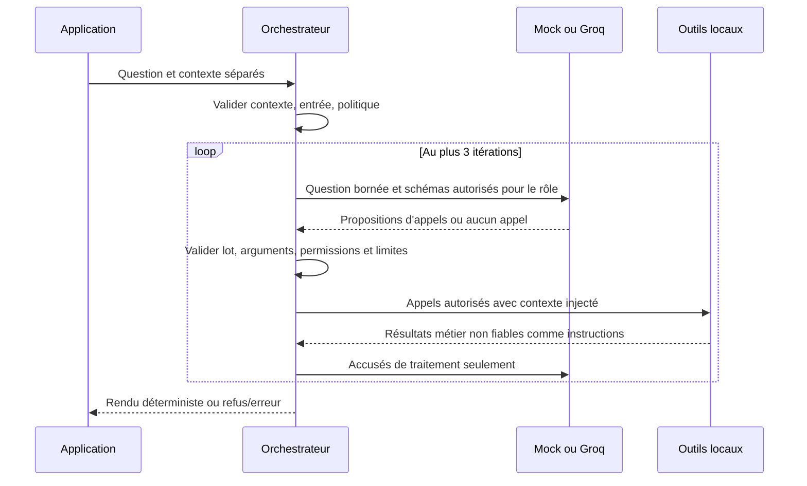

# Orchestration et intégration Groq — tâche 4

## Architecture et contrat

`src/agent.py` réutilise les trois outils métier inchangés. `src/schemas.py` fournit les contrats de tool calling et les validations locales. `src/llm_client.py` isole le SDK Groq officiel et un mock scripté. Python 3.11.14 ; dépendance directe fixée à `groq==1.7.0` (dépendances transitives résolues par pip, sans verrouillage complet).

```python
from src.agent import run_agent
from src.llm_client import MockClient

result = run_agent('Où est ma commande ?',
                   {'role':'client', 'customer_id':'CLI-001'}, client=MockClient())
# Exécuté dans les tests : status='clarification', tools_called=[]
```

Signature : `run_agent(question, context, *, client=None, history=None, config_path=None)`. Le client par défaut est mock, jamais Groq implicitement. `context` est fourni séparément par l'application : `role` parmi client, analyste, administrateur ; `customer_id` obligatoire pour le client, absent ou `None` pour les deux rôles internes. Aucune clé supplémentaire n'est acceptée. Il s'agit d'une identité de démonstration, pas d'une authentification réelle. La future application doit établir et protéger ce contexte côté serveur ; ne jamais le construire depuis un message ou une sortie LLM.

`history` est une liste de questions textuelles précédentes, sans messages système, assistant ou résultats métier injectables. Les quatre dernières au maximum sont utilisées. Le contexte n'est pas conservé globalement entre interactions. `config_path` est un paramètre de l'application, jamais un argument d'outil ou une entrée extraite d'une question.

Retour JSON : `status` (`ok`, `clarification`, `refused`, `error`), `answer` (texte), `tools_called` (noms effectivement exécutés), `sources` (identifiants FAQ), `error_type` (type ou null), `results` (résultats métier en succès, vide sinon). Le champ `answer` utilise des gabarits français déterministes : FAQ avec source, suivi avec statut traduit et dates disponibles, synthèse avec période, référence, comptes et montants. Les chaînes monétaires exactes sont affichées avec une virgule décimale et des espaces entre les groupes de milliers, sans conversion en float. Les dates de la réponse sont affichées en français ; les dates ISO du JSON restent inchangées. Une date réelle absente n'est pas inventée. Les champs JSON et les résultats bruts (`results`) restent inchangés ; aucune reformulation libre du modèle n'est utilisée. L'absence de correspondance FAQ reste un résultat explicite `not_found` dans `results`.

## Séquence et frontières



Une demande simple dont la couverture est établie se termine localement après succès du lot complet, via `render_results`, sans tour LLM de clôture. Sinon, un tour sans appel rend les résultats en succès uniquement si la couverture reconnue est complète ; une demande incomplète demande une précision, et les résultats d’une demande non reconnue sont explicitement marqués partiels. Sans résultat, il demande une clarification en mode `auto`, mais retourne `error_type=tool_selection` si la demande a été reconnue complète et requiert un outil. Un lot multi-outils est entièrement validé avant le premier appel. Les appels locaux s'exécutent séquentiellement. Un refus ou une erreur arrête l'interaction et masque tous les résultats accumulés ; la liste des outils déjà appelés reste factuelle. Le modèle ne reçoit jamais les réponses FAQ, statuts individuels, montants ou identités du contexte : seuls les accusés `ok` ou `not_found` sont renvoyés pour terminer la planification.

La liste blanche contient exactement `search_faq`, `get_order_status`, `sales_summary`. Le modèle ne peut fournir que `query`, `order_id` ou `period` respectivement. Les clés additionnelles, dont `role` et `customer_id`, sont rejetées. Le contexte est injecté par l'orchestrateur. Le client est refusé pour analytics, l'analyste pour le suivi ; les outils réappliquent leurs permissions et contrôlent la propriété. Les refus de sécurité ne sont jamais reformulés par un modèle.

Un identifiant de commande doit apparaître dans la question actuelle. La période peut être définie par deux dates ISO `YYYY-MM-DD` ou un mois français explicitement accompagné de son année : `septembre 2026`, `ventes de septembre 2026`. La conversion locale utilise le premier jour et `calendar.monthrange` pour le dernier, sans horloge système. La casse et les accents sont normalisés ; février bissextile est pris en compte. Les bornes normalisées sont ajoutées au message de planification, sans résultat métier ni donnée individuelle supplémentaire. La période proposée par le modèle doit correspondre exactement à celle extraite localement ; sinon, une précision est demandée avant tout appel.

Un mois sans année, plusieurs mois, une expression relative (`ce mois`, `mois dernier`), un début ouvert (`depuis septembre 2026`) ou un jour en langage naturel (`15 septembre 2026`) restent hors du convertisseur et demandent une précision. Les formats mixtes mois/ISO et les dates invalides sont également refusés comme ambigus. Cette restriction conservatrice réduit les inférences inventées ; elle ne constitue pas un analyseur exhaustif du français. L'historique n'est pas une source d'identifiants ou de périodes implicitement autorisés.

Le contrôle lexical préalable refuse les motifs de mutation, remboursement exécuté, export, changement de rôle et plusieurs formulations d'injection françaises/anglaises. Il peut produire des faux positifs, notamment sur des questions informatives formulées avec ces mots, et ne constitue pas un détecteur universel d'injection. La frontière structurelle reste la lecture seule, la validation stricte, les permissions déterministes et l'absence de rôle choisi par le modèle. Les textes documentaires restitués doivent rester considérés comme non fiables par une future interface ou un futur modèle. Aucune exécution de code n'est disponible.

## Configuration

`configs/agent.yaml` utilise volontairement la syntaxe JSON, sous-ensemble valide de YAML : seuls ces paramètres entiers sont acceptés, sans dépendance YAML additionnelle. Un fichier YAML utilisant des syntaxes hors JSON est refusé.

| Paramètre | Défaut | Limite admise | Justification |
| --- | --- | --- | --- |
| max_iterations | 3 | 1–10 | Sélection, complément éventuel et clôture |
| max_tool_calls | 3 | 1–10 | Plusieurs fonctions sans boucle coûteuse |
| api_timeout_seconds | 10 | 1–60 | Délai réseau conservateur par requête SDK |
| max_output_tokens | 512 | 64–2048 | Réserver la sortie aux arguments courts |
| max_input_chars | 1500 | 1–10000 | Borner question et chaque message d'historique |
| max_history_messages | 4 | 0–10 | Limiter la taille du contexte |

Aucune relance SDK automatique (`max_retries=0`). Le timeout SDK porte sur les opérations réseau, pas sur une garantie de durée totale murale de l'interaction. Le budget de génération maximal par défaut est 3 × 512 tokens de sortie ; les tokens d'entrée restent également bornés par les messages et schémas. Les données locales sont petites ; aucun moteur d'annulation d'outil local n'est introduit.

Les erreurs structurées distinguent contexte/entrée invalide, configuration, réponse LLM invalide, arguments invalides ou JSON mal formé, outil inconnu, refus d'accès, politique, timeout, quota, fournisseur, erreur d'outil et limites d'appels/itérations. Aucun détail SDK, chemin ou traceback n'est renvoyé à l'utilisateur. Un fournisseur non configuré échoue sans appel réseau. Un appel sans arguments requis ne s'exécute pas.

## Groq : configuration et test manuel facultatif

L'adaptateur utilise `Groq(..., timeout=..., max_retries=0)` puis `chat.completions.create` avec `tools`, `tool_choice='auto'`, `max_completion_tokens` et `temperature=0`. Aucun modèle par défaut n'est codé en dur. `GROQ_MODEL` doit désigner un modèle disponible sur le compte et compatible avec le tool calling. `GROQ_API_KEY` doit être injectée via les réglages sécurisés ou l'environnement ; aucun fichier `.env` n'est chargé implicitement.

Sources officielles consultées : [SDK Groq](https://github.com/groq/groq-python), son [README](https://github.com/groq/groq-python/blob/main/README.md) et les [paramètres de completion](https://github.com/groq/groq-python/blob/main/src/groq/types/chat/completion_create_params.py). La page [tool use](https://console.groq.com/docs/tool-use) a renvoyé HTTP 403 dans ce cloud ; les signatures ont été vérifiées dans le SDK officiel et sur son transport simulé.

Commandes depuis la racine, réellement exécutées pour le mode mock et les tests :

```bash
PIP_CACHE_DIR=/tmp/commercepilot-pip-cache .venv/bin/python -m pip install -r requirements.txt
.venv/bin/python -m src.agent --mode mock
.venv/bin/python -m unittest discover -s tests -p test_agent.py -v
.venv/bin/python -m unittest discover -s tests -v
.venv/bin/python data/validate_data.py
PIP_CACHE_DIR=/tmp/commercepilot-pip-cache .venv/bin/python -m pip check
```

La CLI mock est une démonstration scriptée FAQ ; ce n'est pas un moteur de compréhension automatique du français. Les tests peuvent injecter des plans multi-outils, erreurs ou tours supplémentaires. L'API Python permet ces scénarios avec `MockClient(steps)` ; chaque étape est `{'calls': [{'id': 'c1', 'name': ..., 'arguments': '<JSON>'}]}`, ou une exception simulée. Une liste d'appels vide termine le plan.

Après injection sécurisée de la clé et choix de `GROQ_MODEL`, une personne pourra lancer **une seule interaction** manuelle (jusqu'à trois requêtes API selon les limites) :

```bash
.venv/bin/python -m src.agent --mode groq --question 'Quels sont les délais de livraison ?'
```

Cette commande distante a été exécutée deux fois au cours de deux vérifications distinctes ; les résultats sont détaillés ci-dessous. Ne pas l'ajouter aux tests automatiques. Vérifier le modèle sur le compte avant exécution ; ne jamais capturer la clé. En cas de `provider`, vérifier présence des variables, modèle, accès réseau et permissions sans afficher les valeurs. Pour `quota` ou `timeout`, attendre ou vérifier le compte plutôt que boucler automatiquement. Une réponse `clarification` demande un identifiant explicite, deux dates ISO ou un mois français accompagné de son année. Une erreur de configuration requiert un JSON valide dans le fichier YAML.

## Vérifications observées

30 tests d'agent/adaptateur, 15 tests d'outils et 3 tests de données : **48 réussis, aucun échec**. Les cinq tests ciblés ajoutés vérifient la conversion mensuelle (dont les années bissextiles), son intégration à la planification, les ambiguïtés et contradictions, le rendu français avec conservation des résultats JSON et les valeurs absentes (date de livraison, FAQ sans résultat, période sans commande). Les tests SDK utilisent `httpx.MockTransport` et une valeur fictive non secrète : ni clé réelle, ni facturation, ni réseau. Les réponses HTTP 429/500, timeout simulé, erreurs fournisseur, mauvais arguments et sorties, injections, permissions, outils inconnus, multi-outils, limites et absence de clé sont couverts. Les données de référence et outils métier ne sont pas modifiés. L'exemple CLI mock retourne `ok`, `tools_called=['search_faq']` et `sources=['FAQ-002']`. Ces résultats initiaux étaient hors ligne ; la vérification distante complémentaire est décrite ci-dessous. Cette suite ne constitue pas une preuve de sécurité en production.


## Correction de la sélection et vérification distante du 9 novembre 2026

### Premier essai réel

Sur `origin/main` au commit `e6f473ede97d4dbf6f1a2e596f70dd51925c92cb`, la question « Quels sont les délais de livraison ? » a retourné `clarification`, sans outil ni source. Aucune erreur technique API n'était signalée. Les métadonnées de fin de génération n'étaient pas conservées ; on ne peut pas attribuer rétrospectivement cet échec à une limite de tokens.

### Diagnostic et politique corrigée

Les descriptions des fonctions étaient leurs seuls noms, le prompt n'imposait pas explicitement la consultation d'un outil pour une question complète, et `tool_choice=auto` était systématique. Une absence d'appel était toujours assimilée à une ambiguïté. Ces facteurs sont établis dans le code ; leur contribution respective au comportement du modèle n'a pas été isolée expérimentalement.

Les descriptions précisent désormais usages, paramètres et permissions. Le prompt demande explicitement un appel pour une demande claire, sans autoriser de réponse métier de mémoire. Une reconnaissance lexicale conservatrice identifie certains besoins complets : délais/frais/zones de livraison et quelques politiques générales, suivi avec un unique identifiant explicite, ventes avec une période normalisée. Les alternatives, négations, incertitudes reconnues et informations manquantes restent en `auto`. Une demande commerciale de client ou de suivi d'analyste n'active jamais `required`. Les autres paraphrases restent en `auto` : ce mécanisme n'est pas un analyseur exhaustif du français et peut manquer des ambiguïtés complexes.

Au premier tour seulement, une demande reconnue complète et autorisée active `required`. Le modèle choisit toujours la fonction et ses arguments parmi les schémas filtrés selon le rôle ; le prédicat ne déclenche aucun outil local. Les contrôles existants d'arguments, de période, d'identifiant, de propriété et de permission restent actifs. Après un résultat, `auto` autorise la clôture. Un fournisseur qui ne sélectionne rien malgré `required` produit `tool_selection`, distinct d'une clarification. `parallel_tool_calls=False` permet la planification séquentielle sans imposer la prise en charge des appels parallèles ; les lots éventuels restent validés entièrement et exécutés localement en séquence.

Les limites restent inchangées : trois itérations et appels locaux, 512 tokens de sortie, timeout de dix secondes et aucune relance SDK. Les fins `length` et `content_filter` arrêtent l'interaction avant utilisation de la sortie. La CLI expose seulement `provider_metadata` : politique et motif de fin sur liste blanche, sans texte du modèle, raisonnement privé, secret ni identifiant de requête. Une entrée est créée par invocation SDK tentée ; un motif reçu confirme une réponse API, sans prétendre mesurer le trafic réseau général.

### Validation hors ligne

Python 3.11.14, SDK Groq 1.7.0 : **59 tests réussis**, comprenant les 48 existants et 11 nouveaux tests. Mocks et transport HTTP simulé vérifient FAQ complète, vraie ambiguïté, commande sans identifiant, commerce autorisé/interdit, schémas filtrés, `required` puis `auto`, absence de `tool_calls`, troncature, non-divulgation de texte privé et maintien des validations. Le validateur de données réussit et `git diff --check` ne signale aucune erreur. Aucun fichier de données ni outil métier n'a été modifié.

### Deuxième essai réel : sélection corrigée, clôture encore en échec

La commande `.venv/bin/python -m src.agent --mode groq --question "Quels sont les délais de livraison ?"` a été exécutée une seule fois après réussite des contrôles hors ligne, sur la branche locale `fix/groq-tool-selection` issue du commit ci-dessus. Les deux variables Groq étaient présentes et non vides ; leurs valeurs n'ont pas été affichées ou enregistrées.

| Observation | Résultat |
| --- | --- |
| Requête API 1 | `tool_choice=required`, `finish_reason=tool_calls` |
| Outil effectivement exécuté | `search_faq` |
| Requête API 2, clôture | `tool_choice=auto`, `finish_reason=length` |
| Statut final | `error`, `error_type=provider` |
| Réponse finale | Le fournisseur est indisponible ou non configuré. |
| Sources et résultats exposés | Listes vides selon la politique de masquage en erreur |

Deux réponses API ont donc été observées, sans nouvelle interaction ni répétition automatique. La sélection recherchée est obtenue, mais le scénario complet n'est pas validé : la clôture atteint la limite de sortie. Le message générique fournisseur doit être interprété avec la métadonnée `length`, et ne prouve pas une configuration absente. Le contenu privé de génération n'a pas été journalisé ni analysé.

La réponse documentaire attendue, vérifiée hors ligne, est « La date prévue est fixée à cinq jours calendaires après la commande ; il ne s’agit pas d’une garantie. », source AtlasShop `FAQ-002` (`data/faq.csv`, également documentée dans `data/faq.md`). Cette réponse n'a pas été restituée lors du nouvel essai réel ; on ne revendique donc pas de citation distante réussie. Aucun nouvel appel n'a été lancé pour résoudre la clôture. La tâche 5 n'est pas commencée ; aucun commit ni push n'a été réalisé.


## Clôture déterministe — validation complémentaire du 9 novembre 2026

### Cause confirmée du défaut précédent

Après exécution réussie de la FAQ, l'orchestrateur attendait encore un tour sans outil pour appeler `render_results`. Ce deuxième appel ne produisait aucune donnée métier nécessaire : il servait à clore la planification. Sa métadonnée `finish_reason=length` confirme une limite de génération atteinte ; l'adaptateur rejetait alors la réponse et l'orchestrateur masquait les données déjà obtenues. La part exacte du raisonnement interne dans le budget épuisé n'a pas été mesurée ni inspectée.

`max_completion_tokens` demeure fixé au budget existant de 512 tokens, qui couvre la génération du modèle, y compris ses tokens de raisonnement. Aucun budget n'a été augmenté. L'adaptateur ajoute `reasoning_effort=low` uniquement pour les identifiants explicitement reconnus `openai/gpt-oss-20b` et `openai/gpt-oss-120b` ; les autres modèles ne reçoivent pas ce paramètre. Ce réglage vise à réduire la génération de raisonnement, sans revendiquer une économie de tokens mesurée. Les fins `length` et `content_filter` restent des erreurs et aucun appel d'outil issu d'une sortie tronquée n'est exécuté.

### Conditions de clôture et couverture

`completion_needs` reconnaît des clauses complètes selon une grammaire volontairement étroite : livraison/délais de livraison, suivi/statut d'une commande explicite et synthèse de ventes sur une période complète. Toute clause supplémentaire inconnue invalide la preuve de couverture. `needs_satisfied` vérifie les fonctions réellement exécutées et leurs arguments : thème livraison/délai pour la FAQ, identifiant exact pour le suivi, période exacte pour les ventes. Le modèle continue de choisir ses outils et arguments ; ce contrôle ne les appelle pas à sa place.

Une demande reconnue avec **un seul besoin**, satisfait après validation et succès de tout le lot, utilise directement `render_results`. Aucun refus, `not_found`, erreur métier ou résultat mal formé ne déclenche cette clôture. Les besoins multiples conservent la planification séquentielle en `auto` et les limites de trois requêtes/itérations et trois appels locaux. FAQ puis suivi restent possibles sur deux tours de sélection, suivis d'un tour de fin. Un arrêt du modèle alors qu'un besoin reconnu manque retourne `clarification/incomplete_plan` sans résultat métier exposé. Si la demande complète n'a pas pu être reconnue, les résultats éventuels sont présentés comme « Résultats partiels », avec `clarification/incomplete_plan`, jamais comme un succès complet. Les refus et erreurs continuent de masquer les résultats.

Le reconnaisseur reste conservateur et limité au français couvert par sa grammaire ; il ne prouve pas la compréhension de toutes les paraphrases. Les demandes non reconnues peuvent donc nécessiter une précision. Les permissions, contrôles de propriété, validations de lots, limites d'entrée et d'historique et outils métier restent inchangés.

### Tests hors ligne

**70 tests réussis** : les 59 tests précédents maintenus avec adaptation des attentes devenues obsolètes (tour de clôture supprimé, résultats incomplets explicitement signalés), et 11 tests de clôture supplémentaires. Le test de limite d'itérations utilise désormais une demande à deux besoins pour vérifier qu'un besoin manquant ne se termine pas prématurément. Le test d'absence de résultat FAQ conserve le message documentaire tout en vérifiant l'état de clarification pour une demande non reconnue.

Les nouveaux tests couvrent FAQ, commande et analytics en un tour, deux outils en séquence, besoin restant manquant, clause inconnue, ambiguïté, refus et panne métier, mauvais thème FAQ, budget d'itérations/appels et une réponse SDK `length` contenant pourtant un appel d'outil. Le transport HTTP simulé vérifie le réglage GPT-OSS, sa non-transmission aux autres modèles, les 512 tokens et `max_retries=0`. Aucune requête réelle n'est incluse dans les tests. Le validateur des données et `git diff --check` réussissent.

### Troisième essai réel : succès de bout en bout

Une seule nouvelle interaction a été lancée après réussite des contrôles hors ligne, via la CLI existante, Python 3.11.14, branche locale `fix/groq-tool-selection`, sans commit ni push. La présence des variables a été vérifiée sans exposition ni stockage de leurs valeurs.

| Observation réelle | Résultat |
| --- | --- |
| Statut final | `ok` |
| Outil exécuté | `search_faq` |
| Source | `FAQ-002`, AtlasShop, version 1.0 |
| Erreur | `null` |
| Requêtes Groq observées | 1 réponse API, `required` / `tool_calls` |
| Tour Groq de clôture | Aucun |

Réponse effectivement obtenue : « La date prévue est fixée à cinq jours calendaires après la commande ; il ne s’agit pas d’une garantie. (Source : FAQ-002.) » Elle correspond à la réponse documentaire de l'outil et n'est pas rédigée par le modèle.

Le passage de deux réponses API lors de l'essai précédent à une lors de ce nouvel essai est observé pour cette question uniquement. Aucune mesure de coût, de latence ou de tokens consommés n'est revendiquée. Aucune répétition automatique ni nouvelle interaction n'a été lancée. Les données AtlasShop et les trois outils métier sont inchangés. La tâche 5 n'est pas commencée.


### Reconnaissance des formulations de suivi et validation réelle finale — 9 novembre 2026

Le contrôle de complétude ne reconnaissait auparavant que des formulations étroites telles que « Suivi CMD-DEMO-001 ». La formulation « Où est ma commande CMD-DEMO-001 ? » donnait donc `completion_needs=None` malgré un résultat métier exact, et le tour de fin la présentait comme partielle (`clarification/incomplete_plan`). Le filtre préalable de sélection normalisait aussi « où » en « ou », puis pouvait le confondre avec une alternative. Ce défaut concernait la reconnaissance, pas les permissions ni les données.

La correction reste dans les fonctions de reconnaissance de `src/agent.py` : normalisation commune des accents, casse, espaces et ponctuation, avec conservation des identifiants et des séparateurs de clauses ; reconnaissance ancrée de chaque clause de consultation par `order_intent`. Les formulations suivantes sont reconnues : « Où est ma commande CMD-DEMO-001 ? », « Quel est le statut de CMD-DEMO-001 ? », « Suivi CMD-DEMO-001 », « Où en est ma commande CMD-DEMO-001 ? » et « Ma commande CMD-DEMO-001 a-t-elle été livrée ? ». Une simple mention d'identifiant ne suffit pas. Les besoins reconnus et leurs permissions sont consultés avant le filtre conservateur d'incertitude, ce qui distingue l'interrogatif « où » d'une alternative.

La séparation des clauses accepte aussi « ? Et … » sans perdre le second besoin. Une demande suivi + FAQ doit toujours satisfaire les deux besoins ; un besoin manquant conserve une clarification. Pour préparer la question exacte de validation commerciale sans reproduire le défaut de grammaire, le préfixe « Résume les ventes de … » est également reconnu lorsque la période est complète. Le moteur de rendu, les conditions de clôture, le client Groq, les limites et les outils métier n'ont pas été modifiés dans cette correction. Les mutations restent refusées avant tout appel ; la propriété, les permissions et l'interdiction des arguments de rôle ou d'identité restent contrôlées.

**Validation hors ligne : 77 tests réussis**, incluant les 70 précédents et 7 nouveaux tests paramétrés. Ils vérifient les variantes de formulation et de normalisation, les commandes autorisées et interdites, l'identifiant absent, les mentions ambiguës, le suivi combiné à la FAQ, les besoins insatisfaits, les mutations/remboursements, les arguments de contexte injectés, les permissions d'analyste et la formulation exacte des ventes. Le validateur des données et `git diff --check` réussissent. Aucune donnée AtlasShop ni aucun des trois outils métier n'a été modifié.

#### Essai réel de suivi

Une seule interaction `run_agent` avec le véritable `GroqClient` a été exécutée pour « Où est ma commande CMD-DEMO-001 ? », contexte `role=client`, `customer_id=CLI-001`.

- Statut final : **`ok`** ; outil exécuté : **`get_order_status`** ; erreur : **`null`**.
- Résultat exactement égal à celui de l'outil déterministe sous ce contexte, qui valide la propriété de la commande.
- Une seule réponse API observée : `required/tool_calls`. Aucun appel de clôture.
- Réponse réelle : « Commande CMD-DEMO-001 : livrée. Date de livraison prévue : 2026-07-22. Livraison effectuée le 2026-07-22. »

Le nombre de réponses API pour cette même formulation est passé de deux dans l'essai précédent à une dans ce nouvel essai, et le statut est passé de clarification à succès. Aucune mesure de coût, latence ou consommation de tokens n'est revendiquée.

#### Essai réel d'analyse des ventes

Après succès du suivi uniquement, une seule interaction a été exécutée pour « Résume les ventes de septembre 2026. », contexte `role=analyste`, sans `customer_id`.

- Statut final : **`ok`** ; outil exécuté : **`sales_summary`** ; erreur : **`null`**.
- Période normalisée : **2026-09-01 au 2026-09-30 inclus**.
- Tous les résultats sont exactement égaux à `sales_summary` exécuté localement pour cette période et ce rôle ; le rendu correspond exactement à `render_results`.
- Une seule réponse API observée : `required/tool_calls`. Aucun appel de clôture.
- Les schémas proposés excluent le suivi individuel pour ce rôle. Le contrôle des messages sortants n'a détecté aucun identifiant de client ou de commande ni champ `customer_id`/`order_id` ; aucun résultat métier individuel n'a été envoyé. Seuls des booléens de vérification ont été imprimés, sans contenu de raisonnement privé.

Réponse réelle : « Synthèse du 2026-09-01 au 2026-09-30 inclus (états au 2026-10-01) : 87 commande(s). Montant total commandé : 109544,30 MAD. Montant des commandes payées : 66261,30 MAD. Chiffre d’affaires réalisé : 29157,20 MAD. Annulations : 2 (2082,30 MAD). Retours : 1 (2252,50 MAD). Retards : 12, dont 4 livraisons initiales tardives et 8 commandes en cours. »

La FAQ déjà validée n'a pas été relancée : son dernier résultat reste `ok`, `search_faq`, source `FAQ-002`, une requête API. Les trois outils ont ainsi chacun un scénario réel validé, sans prétendre à une évaluation exhaustive des paraphrases, des modèles ou de la sécurité de production. La reconnaissance reste conservatrice sur les formulations non prévues. Les deux nouvelles interactions n'ont été exécutées qu'une fois chacune, sans répétition ni erreur fournisseur. La branche locale `fix/groq-tool-selection` et les changements antérieurs sont préservés. Aucune valeur secrète affichée ou enregistrée, aucun commit ni push ; tâche 5 non commencée.


## Qualité conversationnelle des réponses — tâche 4

Le rendu reste intégralement déterministe dans `render_results`, sans nouvelle génération LLM. Les formats français sont indépendants de la locale système : `french_date` transforme les dates ISO en « 22 juillet 2026 » ou « 1er septembre 2026 » ; `french_mad` groupe les milliers et conserve exactement les deux décimales des chaînes métier, sans conversion en flottant. Une valeur d'affichage mal formée conduit à une erreur générique, sans exposer son contenu.

Le suivi emploie « Votre commande … est … ». La date effective est distinguée de la date prévue ; « à la date prévue » apparaît uniquement si les deux dates sont identiques. Une date effective absente n'est pas inventée, y compris pour une commande annulée ou encore en cours. Les statuts restent ceux de l'outil.

La FAQ conserve son texte documentaire, notamment les réserves sur les délais, puis affiche une référence lisible : « Référence : FAQ AtlasShop, FAQ-002. ». Les ventes commencent par une phrase de bilan avec période française, nombre de commandes et date de référence des statuts. Les montants commandés, payés et réalisés restent trois indicateurs distincts, présentés sur des lignes séparées. Annulations, retours et deux catégories de retards conservent leurs valeurs et leur sens. Les réponses combinées ont des intitulés courts séparant les résultats, avec toutes les sources conservées.

Les demandes de précision mentionnent le numéro de commande ou la période selon la question ; elles n'altèrent pas les statuts ni la validation des arguments. Une absence de réponse FAQ est formulée courtoisement. Une commande inexistante et une commande d'un autre client restent indiscernables : « Je ne peux pas afficher cette commande : elle est introuvable ou votre profil ne permet pas de la consulter. Vérifiez le numéro indiqué. ». Ce message n'affirme jamais qu'une commande protégée existe. Les refus et erreurs ne deviennent pas des réponses positives ; les résultats partiels restent explicitement indiqués.

Seul le texte `answer` est reformulé. La forme du retour, les statuts, `error_type`, `tools_called`, `sources` et les objets métier de `results` restent inchangés. Les données AtlasShop, les trois outils, les permissions, la sélection des outils et les budgets d'appels restent inchangés. Le nouveau texte ne déclenche aucun appel de clôture.

Validation hors ligne : **89 tests réussis**, soit les 77 précédents (attentes textuelles adaptées au nouveau rendu) et 12 nouveaux tests de français, dates, montants exacts, statuts, dates absentes/différentes, résultats combinés, conservation du JSON, refus neutres, clarifications et erreurs d'affichage. Le validateur des données et `git diff --check` réussissent. **Aucun nouvel appel réel Groq n'a été lancé** pour cette amélioration rédactionnelle ; les essais réels précédents restent des observations historiques.

Exemples vérifiés hors ligne :

- FAQ : le texte sur les cinq jours calendaires et l'absence de garantie reste inchangé ; « (Source : FAQ-002.) » devient une ligne « Référence : FAQ AtlasShop, FAQ-002. ».
- Suivi : « Commande CMD-DEMO-001 : livrée. Date de livraison prévue : 2026-07-22. Livraison effectuée le 2026-07-22. » devient « Votre commande CMD-DEMO-001 est livrée. La livraison a eu lieu le 22 juillet 2026, à la date prévue. ».
- Ventes : l'ancien paragraphe « Synthèse du 2026-09-01 au 2026-09-30 inclus … 87 commande(s). Montant total commandé : 109544,30 MAD … » devient une introduction « Voici le bilan du 1er septembre 2026 au 30 septembre 2026 inclus : 87 commandes. Les statuts sont ceux du 1er octobre 2026. », suivie de lignes distinctes pour 109 544,30 MAD commandés, 66 261,30 MAD payés, 29 157,20 MAD réalisés, les annulations, retours et retards.

Limites : gabarits français fixes et couverture d'intentions conservatrice, sans reformulation libre ni personnalisation. Une information documentaire n'est pas enrichie au-delà de sa source. L'authentification reste simulée et la non-divulgation impose le même message pour commande absente ou inaccessible. Aucun commit ni push ; tâche 5 non commencée.


## Derniers ajustements après l'évaluation conversationnelle — tâche 4

La reconnaissance documentaire couvre désormais des formulations bornées et des paraphrases des délais, zones, frais, week-ends et retards de livraison, des moyens de paiement, des délais/conditions/procédures de retour et des délais/caractère partiel d'un remboursement. `FAQ_INTENTS` associe ces intentions aux références existantes du catalogue. Le modèle garde le choix des fonctions et des requêtes ; aucun outil n'est déclenché par ce catalogue. Une FAQ ne satisfait le besoin que si l'outil a réellement retourné `ok` avec la référence attendue. Un résultat `not_found`, une autre référence ou une clause supplémentaire non reconnue ne déclenchent pas de clôture complète. Les demandes combinées doivent toujours couvrir chaque besoin.

L'ancien filtre lexical refusait aussi le nom « remboursement ». Une exception strictement bornée autorise les questions informatives reconnues de FAQ-020 et FAQ-021. Seul ce nom est neutralisé pour ce contrôle ; les verbes d'exécution, mutations, demandes directes de remboursement, injections et changements de rôle restent refusés. Une clause de remboursement non reconnue conserve le refus conservateur. Ce n'est pas une autorisation d'effectuer un remboursement : aucun outil de mutation n'existe.

Un bilan sans commande devient un court paragraphe indiquant la période, l'absence de ventes et la date de référence. Tous les indicateurs détaillés restent présents dans `results`. Le bilan non vide distingue toujours montant commandé et montant des commandes payées ; le libellé du chiffre d'affaires précise maintenant « commandes livrées et payées », sans changement du calcul.

Les titres des résultats combinés reprennent le sujet documentaire, par exemple « Délais de livraison » ou « Conditions de retour ». Le suivi précise explicitement « Selon les données de démonstration au 1er octobre 2026 … » et emploie un temps historique, à partir de la constante de référence existante, sans modifier le JSON de l'outil ni prétendre à une mise à jour en temps réel.

Le traitement des lots reste atomique : un lot contenant un appel interdit n'est jamais exécuté, y compris sa partie autorisée. Pour un client demandant des ventes, le refus nomme la restriction et rappelle que les renseignements généraux sur la livraison restent accessibles séparément. Le résultat reste `refused/access_denied`, avec `tools_called=[]`, `results=[]` et `sources=[]` pour le lot mixte testé. Aucun succès partiel ni traitement automatique d'un sous-lot n'est ajouté. Un refus sur un tour ultérieur continue de masquer les résultats déjà obtenus.

Validation : **101 tests réussis** (89 précédents avec adaptation des attentes de présentation et de la référence documentaire de la fixture de non-transmission, plus 12 tests de régression). Les nouveaux tests incluent dix paraphrases, la correspondance de référence, les demandes de remboursement informatives et exécutoires, les injections, les clauses inconnues, deux FAQ distinctes, la conservation des indicateurs du bilan vide, la référence historique, les sujets combinés et le rejet d'un lot mixte dans les deux ordres. Validateur des données et `git diff --check` réussis. Les dix scénarios conversationnels ont également été rejoués avant/après, avec plans mock identiques, outils locaux réels et réseau bloqué. La comparaison détaillée figure dans la section de tâche 4 du rapport progressif.

Les scores éditoriaux de clarté et de naturel restent subjectifs ; ils ne sont pas déduits du nombre de tests. Les limites persistent : français couvert par une grammaire bornée, recherche FAQ lexicale, refus des demandes mixtes au lieu de traiter leur partie autorisée, données historiques et contexte d'identité simulé. Une question générale sur « toutes les conditions » ne prouve pas qu'une seule FAQ suffit. Les formulations non reconnues demandent encore une précision plutôt que de promettre une couverture exhaustive. Aucun appel Groq pour cette correction, aucun commit ni push, tâche 5 non commencée.
