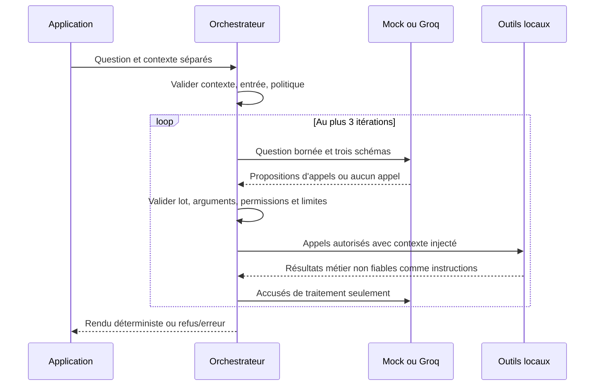

# Orchestration et intégration Groq — tâche 4

## Architecture et contrat

`src/agent.py` réutilise les trois outils métier inchangés. `src/schemas.py` fournit les contrats de tool calling et les validations locales. `src/llm_client.py` isole le SDK Groq officiel et un mock scripté. Python 3.11.14 ; dépendance directe fixée à `groq==1.7.0` (dépendances transitives résolues par pip, sans verrouillage complet).

```python
from src.agent import run_agent
from src.llm_client import MockClient

result = run_agent('Où est ma commande ?',
                   {'role':'client', 'customer_id':'CLI-001'}, client=MockClient())
# Exécuté dans les tests : status='clarification', tools_called=[]
```

Signature : `run_agent(question, context, *, client=None, history=None, config_path=None)`. Le client par défaut est mock, jamais Groq implicitement. `context` est fourni séparément par l'application : `role` parmi client, analyste, administrateur ; `customer_id` obligatoire pour le client, absent ou `None` pour les deux rôles internes. Aucune clé supplémentaire n'est acceptée. Il s'agit d'une identité de démonstration, pas d'une authentification réelle. La future application doit établir et protéger ce contexte côté serveur ; ne jamais le construire depuis un message ou une sortie LLM.

`history` est une liste de questions textuelles précédentes, sans messages système, assistant ou résultats métier injectables. Les quatre dernières au maximum sont utilisées. Le contexte n'est pas conservé globalement entre interactions. `config_path` est un paramètre de l'application, jamais un argument d'outil ou une entrée extraite d'une question.

Retour JSON : `status` (`ok`, `clarification`, `refused`, `error`), `answer` (texte), `tools_called` (noms effectivement exécutés), `sources` (identifiants FAQ), `error_type` (type ou null), `results` (résultats métier en succès, vide sinon). Le champ `answer` utilise des gabarits français déterministes : FAQ avec source, suivi avec statut traduit et dates disponibles, synthèse avec période, référence, comptes et montants. Les chaînes monétaires exactes sont affichées avec une virgule décimale sans conversion en float. Une date réelle absente n'est pas inventée. Les champs JSON et les résultats bruts (`results`) restent inchangés ; aucune reformulation libre du modèle n'est utilisée. L'absence de correspondance FAQ reste un résultat explicite `not_found` dans `results`.

## Séquence et frontières



Un tour sans appel termine avec les résultats déjà obtenus, ou demande une clarification si aucun outil n'a été exécuté. Un lot multi-outils est entièrement validé avant le premier appel. Les appels locaux s'exécutent séquentiellement. Un refus ou une erreur arrête l'interaction et masque tous les résultats accumulés ; la liste des outils déjà appelés reste factuelle. Le modèle ne reçoit jamais les réponses FAQ, statuts individuels, montants ou identités du contexte : seuls les accusés `ok` ou `not_found` sont renvoyés pour terminer la planification.

La liste blanche contient exactement `search_faq`, `get_order_status`, `sales_summary`. Le modèle ne peut fournir que `query`, `order_id` ou `period` respectivement. Les clés additionnelles, dont `role` et `customer_id`, sont rejetées. Le contexte est injecté par l'orchestrateur. Le client est refusé pour analytics, l'analyste pour le suivi ; les outils réappliquent leurs permissions et contrôlent la propriété. Les refus de sécurité ne sont jamais reformulés par un modèle.

Un identifiant de commande doit apparaître dans la question actuelle. La période peut être définie par deux dates ISO `YYYY-MM-DD` ou un mois français explicitement accompagné de son année : `septembre 2026`, `ventes de septembre 2026`. La conversion locale utilise le premier jour et `calendar.monthrange` pour le dernier, sans horloge système. La casse et les accents sont normalisés ; février bissextile est pris en compte. Les bornes normalisées sont ajoutées au message de planification, sans résultat métier ni donnée individuelle supplémentaire. La période proposée par le modèle doit correspondre exactement à celle extraite localement ; sinon, une précision est demandée avant tout appel.

Un mois sans année, plusieurs mois, une expression relative (`ce mois`, `mois dernier`), un début ouvert (`depuis septembre 2026`) ou un jour en langage naturel (`15 septembre 2026`) restent hors du convertisseur et demandent une précision. Les formats mixtes mois/ISO et les dates invalides sont également refusés comme ambigus. Cette restriction conservatrice réduit les inférences inventées ; elle ne constitue pas un analyseur exhaustif du français. L'historique n'est pas une source d'identifiants ou de périodes implicitement autorisés.

Le contrôle lexical préalable refuse les motifs de mutation, remboursement exécuté, export, changement de rôle et plusieurs formulations d'injection françaises/anglaises. Il peut produire des faux positifs, notamment sur des questions informatives formulées avec ces mots, et ne constitue pas un détecteur universel d'injection. La frontière structurelle reste la lecture seule, la validation stricte, les permissions déterministes et l'absence de rôle choisi par le modèle. Les textes documentaires restitués doivent rester considérés comme non fiables par une future interface ou un futur modèle. Aucune exécution de code n'est disponible.

## Configuration

`configs/agent.yaml` utilise volontairement la syntaxe JSON, sous-ensemble valide de YAML : seuls ces paramètres entiers sont acceptés, sans dépendance YAML additionnelle. Un fichier YAML utilisant des syntaxes hors JSON est refusé.

| Paramètre | Défaut | Limite admise | Justification |
| --- | --- | --- | --- |
| max_iterations | 3 | 1–10 | Sélection, complément éventuel et clôture |
| max_tool_calls | 3 | 1–10 | Plusieurs fonctions sans boucle coûteuse |
| api_timeout_seconds | 10 | 1–60 | Délai réseau conservateur par requête SDK |
| max_output_tokens | 512 | 64–2048 | Réserver la sortie aux arguments courts |
| max_input_chars | 1500 | 1–10000 | Borner question et chaque message d'historique |
| max_history_messages | 4 | 0–10 | Limiter la taille du contexte |

Aucune relance SDK automatique (`max_retries=0`). Le timeout SDK porte sur les opérations réseau, pas sur une garantie de durée totale murale de l'interaction. Le budget de génération maximal par défaut est 3 × 512 tokens de sortie ; les tokens d'entrée restent également bornés par les messages et schémas. Les données locales sont petites ; aucun moteur d'annulation d'outil local n'est introduit.

Les erreurs structurées distinguent contexte/entrée invalide, configuration, réponse LLM invalide, arguments invalides ou JSON mal formé, outil inconnu, refus d'accès, politique, timeout, quota, fournisseur, erreur d'outil et limites d'appels/itérations. Aucun détail SDK, chemin ou traceback n'est renvoyé à l'utilisateur. Un fournisseur non configuré échoue sans appel réseau. Un appel sans arguments requis ne s'exécute pas.

## Groq : configuration et test manuel facultatif

L'adaptateur utilise `Groq(..., timeout=..., max_retries=0)` puis `chat.completions.create` avec `tools`, `tool_choice='auto'`, `max_completion_tokens` et `temperature=0`. Aucun modèle par défaut n'est codé en dur. `GROQ_MODEL` doit désigner un modèle disponible sur le compte et compatible avec le tool calling. `GROQ_API_KEY` doit être injectée via les réglages sécurisés ou l'environnement ; aucun fichier `.env` n'est chargé implicitement.

Sources officielles consultées : [SDK Groq](https://github.com/groq/groq-python), son [README](https://github.com/groq/groq-python/blob/main/README.md) et les [paramètres de completion](https://github.com/groq/groq-python/blob/main/src/groq/types/chat/completion_create_params.py). La page [tool use](https://console.groq.com/docs/tool-use) a renvoyé HTTP 403 dans ce cloud ; les signatures ont été vérifiées dans le SDK officiel et sur son transport simulé.

Commandes depuis la racine, réellement exécutées pour le mode mock et les tests :

```bash
PIP_CACHE_DIR=/tmp/commercepilot-pip-cache .venv/bin/python -m pip install -r requirements.txt
.venv/bin/python -m src.agent --mode mock
.venv/bin/python -m unittest discover -s tests -p test_agent.py -v
.venv/bin/python -m unittest discover -s tests -v
.venv/bin/python data/validate_data.py
PIP_CACHE_DIR=/tmp/commercepilot-pip-cache .venv/bin/python -m pip check
```

La CLI mock est une démonstration scriptée FAQ ; ce n'est pas un moteur de compréhension automatique du français. Les tests peuvent injecter des plans multi-outils, erreurs ou tours supplémentaires. L'API Python permet ces scénarios avec `MockClient(steps)` ; chaque étape est `{'calls': [{'id': 'c1', 'name': ..., 'arguments': '<JSON>'}]}`, ou une exception simulée. Une liste d'appels vide termine le plan.

Après injection sécurisée de la clé et choix de `GROQ_MODEL`, une personne pourra lancer **une seule interaction** manuelle (jusqu'à trois requêtes API selon les limites) :

```bash
.venv/bin/python -m src.agent --mode groq --question 'Quels sont les délais de livraison ?'
```

Cette commande distante n'a pas été exécutée : clé et modèle absents. Ne pas l'ajouter aux tests automatiques. Vérifier le modèle sur le compte avant exécution ; ne jamais capturer la clé. En cas de `provider`, vérifier présence des variables, modèle, accès réseau et permissions sans afficher les valeurs. Pour `quota` ou `timeout`, attendre ou vérifier le compte plutôt que boucler automatiquement. Une réponse `clarification` demande un identifiant explicite, deux dates ISO ou un mois français accompagné de son année. Une erreur de configuration requiert un JSON valide dans le fichier YAML.

## Vérifications observées

30 tests d'agent/adaptateur, 15 tests d'outils et 3 tests de données : **48 réussis, aucun échec**. Les cinq tests ciblés ajoutés vérifient la conversion mensuelle (dont les années bissextiles), son intégration à la planification, les ambiguïtés et contradictions, le rendu français avec conservation des résultats JSON et les valeurs absentes (date de livraison, FAQ sans résultat, période sans commande). Les tests SDK utilisent `httpx.MockTransport` et une valeur fictive non secrète : ni clé réelle, ni facturation, ni réseau. Les réponses HTTP 429/500, timeout simulé, erreurs fournisseur, mauvais arguments et sorties, injections, permissions, outils inconnus, multi-outils, limites et absence de clé sont couverts. Les données de référence et outils métier ne sont pas modifiés. L'exemple CLI mock retourne `ok`, `tools_called=['search_faq']` et `sources=['FAQ-002']`. La qualité du routage par un modèle distant reste non évaluée ; cette suite ne constitue pas une preuve de sécurité en production.
