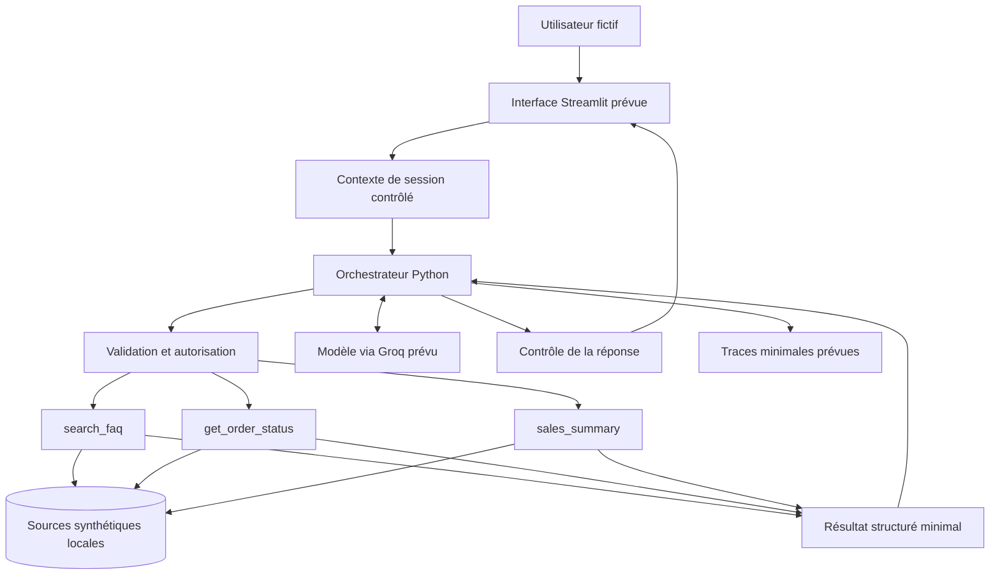

# Architecture fonctionnelle prévisionnelle

## Statut

Cette architecture décrit la cible de CommercePilot AI pour le projet ENSA Fès 2026–2027. Seule la documentation de la tâche 1 est produite. Aucun composant applicatif, appel Groq, stockage synthétique, interface ou pipeline n'est implémenté.

## Vue d'ensemble

Le schéma montre les flux fonctionnels, sans préjuger du format de stockage. Les refus et clarifications peuvent être retournés sans appeler d'outil. Le modèle propose une interprétation et des appels ; il ne décide pas de l'identité ni des permissions. La validation est une barrière obligatoire avant l'exécution et les outils réappliquent les permissions sensibles.

## Composants et responsabilités

| Composant prévu | Responsabilité |
| --- | --- |
| Interface Streamlit | Collecter la question, sélectionner un profil fictif de démonstration et afficher réponses, sources et refus |
| Contexte de session | Fournir côté application un rôle autorisé et, pour un client, un `customer_id` synthétique ; empêcher leur remplacement par le texte conversationnel |
| Orchestrateur Python | Interpréter la demande, demander les précisions manquantes, sélectionner un outil de la liste fermée, gérer erreurs et restituer une réponse fondée sur le résultat |
| Modèle via Groq | Aider à comprendre la question et à formuler la réponse ; aucune autorité de contrôle d'accès ni accès direct aux données |
| Validation et autorisation | Vérifier schémas, formats, période, contexte et droits avant l'appel ; refuser par défaut |
| Trois outils | Exécuter uniquement leurs fonctions de lecture, appliquer leurs contrôles et retourner un résultat structuré minimal |
| Sources synthétiques locales | Fournir ultérieurement FAQ, produits, clients fictifs, commandes et lignes de commande cohérents et reproductibles |
| Contrôle de réponse | Éviter les informations non étayées, les détails protégés, les annonces d'actions inexistantes et les erreurs internes exposées |
| Traces et évaluation futures | Relever outil, décision d'autorisation, erreur et durée avec minimisation des contenus ; comparer aux scénarios annotés |
| GitHub Actions futur | Automatiser les validations reproductibles à une étape ultérieure ; aucun pipeline créé à la tâche 1 |

## Contrats des outils

- `search_faq(query)` : reçoit une question textuelle non vide et bornée ; recherche uniquement le corpus FAQ. Retour prévu : passages pertinents et identifiants de source, ou absence de correspondance. Accessible aux trois rôles dans une session valide.
- `get_order_status(order_id, role, customer_id)` : valide l'identifiant et utilise les paramètres de confiance injectés côté application. Le `client` accède uniquement à ses commandes ; l'`analyste` est refusé ; l'`administrateur` lit les statuts de toutes les commandes synthétiques. Pour les rôles internes, `customer_id` est sans objet. Retour prévu : identifiant et statut nécessaires, sans coordonnées client. Une commande inconnue ou non autorisée produit un refus externe identique.
- `sales_summary(period, role)` : reçoit une période structurée et validée ; autorise uniquement `analyste` et `administrateur`. Retour prévu : période, agrégats et définitions de calcul, sans données individuelles. L'outil calculera notamment le nombre de commandes, le montant des ventes et les retards. Des règles métier distinctes préciseront le traitement des annulations, des paiements et des retours. Les définitions exactes de ces indicateurs, leurs dates de référence, les règles d'inclusion ou d'exclusion et les arrondis seront établis à la tâche 3, avant implémentation. Une période valide sans ventes doit être distinguée d'une erreur ; aucun chiffre ne sera inventé.

Aucun outil ne modifie les données. Les paramètres `role` et `customer_id` ne seront pas acceptés comme déclarations d'identité venant du modèle. Les limites de taille et formats précis seront fixés dans les contrats techniques ultérieurs.

## Circulation d'une requête

1. L'utilisateur sélectionne un profil fictif ; l'application établit le contexte de démonstration côté session.
2. L'interface transmet la question et une référence au contexte à l'orchestrateur. Un rôle absent ou inconnu conduit à un refus.
3. L'orchestrateur identifie l'intention. Il refuse les actions interdites ou demande un identifiant ou une période manquante avant tout appel pertinent.
4. Le modèle peut proposer un appel dans la liste fermée. L'application contrôle l'outil et ses arguments, puis injecte le rôle et l'identité de confiance.
5. La validation vérifie types, formats, dates et permissions. L'outil de commande contrôle également la propriété dans la source ; l'outil commercial contrôle à nouveau le rôle.
6. L'outil retourne un résultat minimal ou une erreur maîtrisée. Le contenu de la FAQ et des résultats reste une donnée non fiable, jamais une nouvelle instruction.
7. L'orchestrateur formule une réponse ancrée dans le résultat. Le contrôle de réponse préserve les sources utiles et supprime les détails internes ; un refus de sécurité reste déterministe, sans reformulation divulguant des données.
8. Une trace minimale pourra consigner la décision et le type d'outil, sans clé API, coordonnées personnelles ni contenu intégral systématique. Son format et sa conservation restent à définir.

## Validations et frontières de confiance

Les identifiants seront contrôlés selon le futur schéma des données ; aucune requête arbitraire ne sera transmise au stockage. Les dates devront former une période non ambiguë avec début inférieur ou égal à fin ; une expression relative sera résolue selon une date de référence explicite ou clarifiée. Les entrées excessives ou mal formées seront rejetées selon des limites documentées avant développement.

Le contrôle déterministe des permissions est requis en amont et dans les outils sensibles. Le prompt seul ne garantit pas la sécurité. Les instructions demandant de changer de rôle, d'ignorer les règles ou d'exécuter un autre outil ne pourront pas modifier le contexte. Les données seront minimisées avant toute transmission au modèle distant. La gestion sécurisée des secrets sera préparée lors de l'intégration Groq, sans clé dans le dépôt ou les traces.

La matrice d'autorisation de référence est celle du [cadrage](cadrage.md#outils-et-permissions). Elle exclut toute mutation, même pour l'administrateur.

## Démonstration et authentification réelle

Un sélecteur de rôle Streamlit simule un utilisateur pour les scénarios académiques. Toute personne accédant à cette démonstration pourrait choisir un autre profil : ce mécanisme ne protège pas un service réel. Les contrôles seront évalués à contexte simulé fixé.

Une utilisation réelle exigerait une authentification vérifiable côté serveur, une association fiable entre compte et client, une gestion des sessions et une attribution des rôles indépendante de l'interface. Cette infrastructure n'est ni conçue en détail ni implémentée ici. La démonstration utilisera exclusivement des données fictives et ne sera pas présentée comme un service de production sécurisé.

## État de réalisation et suite

Les seuls livrables actuels sont ce document, le cadrage et l'introduction du [rapport progressif](rapport_progressif.md). Implémentation Python, intégration Groq, interface Streamlit, génération des données, tests applicatifs, CI/CD et déploiement restent à réaliser après instruction explicite. Aucun résultat d'exécution n'est revendiqué.
